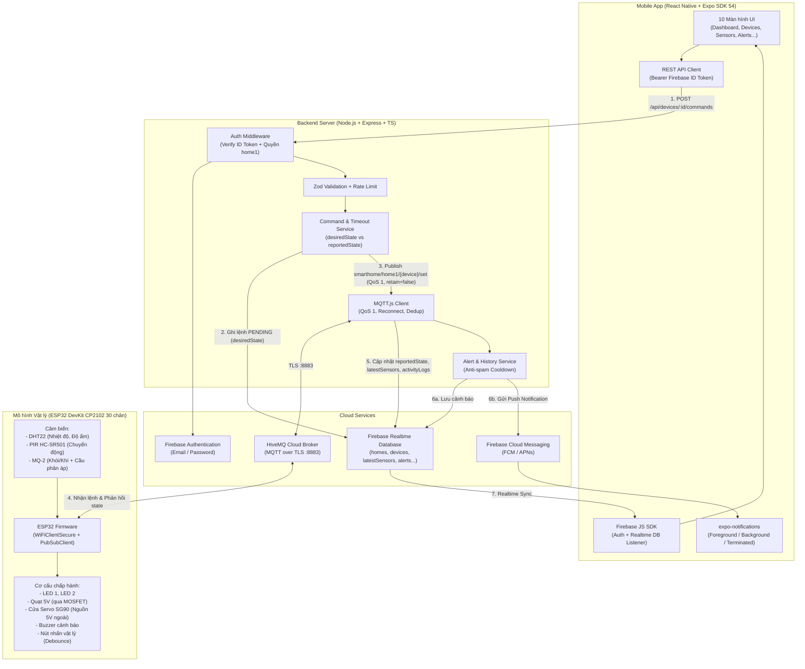

# KIẾN TRÚC HỆ THỐNG – SMART HOME IoT 2026

## 1. Sơ đồ Kiến trúc Tổng thể

---

## 2. Bốn Luồng Dữ Liệu Bắt Buộc

### 2.1. Luồng Điều Khiển (Control Flow)
1. Người dùng nhấn bật/tắt thiết bị (Đèn, Quạt, Cửa, hoặc đổi chế độ `MANUAL`/`AUTO`) trên **Mobile App**.
2. Mobile App chuyển nút sang trạng thái **`PENDING` (Đang xử lý)** — **tuyệt đối không** tự gán thiết bị đã bật ngay khi gọi API.
3. Mobile App gửi request `POST /api/devices/:id/commands` kèm header `Authorization: Bearer <Firebase_ID_Token>`.
4. **Backend Node.js**:
   - Xác thực Firebase ID Token qua `firebase-admin`.
   - Kiểm tra quyền truy cập của `uid` đối với `home1` trong `userHomes/{uid}/home1`.
   - Validate body bằng `Zod`, sinh `requestId` duy nhất (`UUID v4`).
   - Ghi trạng thái lệnh `PENDING` và `desiredState` vào Firebase (`commands/home1/{requestId}` và `devices/home1/{deviceId}/desiredState`).
   - Publish bản tin JSON lên topic `smarthome/home1/{device}/set` với **`QoS = 1`**, **`retain = false`**.
   - Khởi tạo bộ đếm timeout (mặc định `8000ms`). Nếu quá hạn mà chưa nhận được phản hồi từ ESP32, Backend cập nhật trạng thái lệnh thành `TIMEOUT` để Mobile App hiển thị thông báo lỗi.

### 2.2. Luồng Phản Hồi Trạng Thái (State Feedback Flow)
1. **ESP32** nhận bản tin từ `smarthome/home1/{device}/set`, kiểm tra `requestId` trong bộ đệm chống trùng (ring buffer 16 `requestId` gần nhất).
2. Nếu `requestId` mới, ESP32 kích hoạt GPIO điều khiển phần cứng (LED / MOSFET Quạt / Góc quay Servo).
3. Ngay sau khi thực thi, ESP32 publish bản tin xác nhận lên `smarthome/home1/{device}/state` với **`QoS = 1`**, **`retain = true`**, đính kèm `requestId`, `reportedState` và `timestamp`.
4. **Backend Node.js** nhận bản tin `state`, hủy timer timeout của `requestId`, cập nhật `devices/home1/{deviceId}/reportedState`, đánh dấu lệnh `ACKED` trong `commands/home1/{requestId}` và ghi vào `activityLogs/home1`.
5. **Mobile App** nhận thay đổi từ Firebase Realtime Database, tắt trạng thái `PENDING` và hiển thị trạng thái thực tế.

### 2.3. Luồng Dữ Liệu Cảm Biến (Sensor Telemetry Flow)
1. **ESP32** đọc cảm biến theo chu kỳ không chặn (`millis()`, không dùng `delay()` dài):
   - `DHT22`: mỗi `5000ms` (hoặc gửi ngay khi chênh lệch `>= 0.5°C` / `>= 2%` độ ẩm).
   - `PIR HC-SR501`: đọc liên tục, publish ngay khi phát hiện sườn lên/xuống của chuyển động.
   - `MQ-2`: đọc ADC1 (`GPIO34`) mỗi `1000ms` (sau thời gian làm nóng `preheat 20–30s`).
2. ESP32 publish lên các topic `smarthome/home1/sensors/{temperature|humidity|motion|smoke}`.
3. **Backend Node.js** luôn cập nhật `latestSensors/home1` để Dashboard hiển thị tức thời, nhưng **chỉ ghi vào `sensorReadings/home1` theo cơ chế tiết kiệm dung lượng** (throttling mỗi `60 giây` hoặc khi có biến động vượt ngưỡng) để không làm đầy Firebase.

### 2.4. Luồng Cảnh Báo (Alert & Emergency Flow)
1. **Phản ứng cục bộ tại ESP32 (Offline-Safe)**:
   - Ngay khi giá trị `MQ-2` vượt ngưỡng nguy hiểm (sau khi đã qua thời gian làm nóng và lấy mẫu trung bình trượt), ESP32 **lập tức bật Buzzer tại mô hình** và nếu đang ở chế độ `AUTO` thì bật quạt thông gió — ngay cả khi Wi-Fi hoặc Backend bị mất kết nối.
2. **Phản ứng qua Cloud**:
   - ESP32 publish bản tin khẩn cấp lên `smarthome/home1/alerts` (`QoS = 1`).
   - Backend ghi vào `alerts/home1/{alertId}` trên Firebase Realtime Database.
   - Backend kiểm tra cơ chế chống lặp (`cooldown 60 giây` cho cùng một loại cảnh báo) rồi gửi Push Notification qua **FCM** đến các token trong `notificationTokens/{uid}`.

---

## 3. Phân Biệt `desiredState` và `reportedState`

| Thuộc tính | `desiredState` (Trạng thái mong muốn) | `reportedState` (Trạng thái thực tế) |
| :--- | :--- | :--- |
| **Nguồn tạo** | Người dùng trên Mobile App hoặc quy tắc Backend | Duy nhất từ **ESP32** (hoặc Simulator khi test) |
| **Ý nghĩa** | "Tôi muốn bật quạt" | "ESP32 xác nhận đã kích chân MOSFET bật quạt" |
| **Quyền ghi** | Backend ghi khi nhận lệnh từ App | Backend ghi khi nhận bản tin MQTT `.../state` |
| **Hiển thị UI** | Khi `desiredState != reportedState` và lệnh đang `PENDING`: hiện spinner loading | Hiển thị trạng thái chính thức của công tắc trên UI |

> **Đặc biệt với Cửa Servo (`door1`)**: Do mô hình sử dụng Servo SG90 không có công tắc hành trình (reed switch) riêng, `reportedState: "OPEN" | "CLOSED"` phản ánh **trạng thái góc lệnh mà ESP32 đã cấp xung PWM cho Servo**, kèm ghi chú rõ ràng trong dữ liệu (`positionVerified: false`) theo đúng yêu cầu kỹ thuật.

---

## 4. Cơ chế Tự Kết Nối Lại (Auto-Reconnect) & LWT

1. **Last Will and Testament (LWT)**:
   - Khi ESP32 kết nối vào HiveMQ Cloud, nó đăng ký LWT trên topic `smarthome/home1/esp32/status` (`QoS 1`, `retain = true`) với payload `{"online": false, "reason": "lwt_disconnect"}`.
   - Khi kết nối thành công, ESP32 lập tức publish `{"online": true, ...}` (`retain = true`) lên cùng topic.
   - Nhờ đó, nếu ESP32 mất điện hoặc rớt mạng đột ngột, HiveMQ tự động phát bản tin LWT báo cho Backend và Mobile App biết ESP32 đã **Offline**.
2. **Không tự động thực thi lại lệnh cũ nguy hiểm sau Reconnect**:
   - Các topic điều khiển `.../set` luôn được publish với **`retain = false`**.
   - Nhờ vậy, khi ESP32 khởi động lại hoặc kết nối lại Wi-Fi, nó **không** bị nhận lại lệnh mở cửa (`door1/set`) cũ từ broker.
